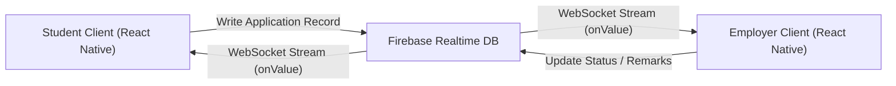

# InternLink: Mobile Internship Platform

[](https://kush-bhattacharya.github.io/internlink-app/)
[-1D4ED8?style=flat)](https://github.com/Kush-Bhattacharya/internlink-app/releases/download/v1.0.0/InternLink-v1.0.0.apk)
[](https://forms.gle/2DrixK9M2mWgT9CQA)
[](https://kush-bhattacharya.github.io/internlink-app/)

InternLink is a cross-platform mobile application designed to connect secondary school and undergraduate students with employers offering entry-level internships. The system implements role-specific interfaces for applicants and recruiters, backed by real-time cloud data synchronization.

---

## Testing and Deployment

The project provides two independent distribution channels for evaluation without requiring local development environments.

### 1. Progressive Web App (PWA) Simulation (iOS / Desktop)
The application interface can be evaluated directly in the browser or installed to an iOS home screen to simulate native execution:

1. Navigate to [https://kush-bhattacharya.github.io/internlink-app/](https://kush-bhattacharya.github.io/internlink-app/) using Safari on iOS or any desktop browser.
2. On iOS Safari, open the **Share** menu (square icon with an upward arrow) and select **Add to Home Screen**.
3. Confirm the shortcut creation. Launching the application from the home screen runs the PWA in standalone mode, hiding browser navigation chrome and enabling full-screen viewport behavior.
4. Desktop users can evaluate the workflow directly within the emulated device viewport.

### 2. Standalone Android Binary (APK)
For native testing on physical Android devices or emulators (Android 8.0 / API level 26 and above):

1. Download the compiled binary directly: [InternLink-v1.0.0.apk](https://github.com/Kush-Bhattacharya/internlink-app/releases/download/v1.0.0/InternLink-v1.0.0.apk) (approx. 103 MB).
2. Install the package on the device (granting temporary permission for installation from external sources if prompted).
3. The APK runs autonomously against the production database.

---

## Evaluation and Feedback

User feedback is collected to evaluate usability and defect reports across specific views:

* Feedback submission form: [https://forms.gle/2DrixK9M2mWgT9CQA](https://forms.gle/2DrixK9M2mWgT9CQA)

### Interface Reference Guide
When referencing specific views in the feedback form, refer to the following screen definitions:

* **Student Onboarding Questionnaire**: Multi-stage registration capturing academic institution, field of study, graduation year, and core technical competencies.
* **Student Home Dashboard**: Main applicant view displaying greeting headers, domain category chips, and recommended job postings.
* **Explore All Internships**: Searchable directory of open listings supporting text queries, location filters, and stipend badges.
* **Internship Details and Application View**: Detailed position specification outlining prerequisites, role responsibilities, and application submission controls.
* **Student Profile and Digital Resume**: Applicant profile management screen displaying educational background, skill tags, and profile completeness metrics.
* **Employer Dashboard**: Recruiter overview displaying high-level recruitment metrics (active postings, total applicants, candidates under review, and accepted offers).
* **Post New Internship Wizard**: Multi-step job creation form collecting position titles, compensation, required skill sets, and eligibility criteria.
* **Manage Posted Internships**: Management view listing active and closed company postings alongside applicant volume counters.
* **Candidate Review and Dossier**: Detailed recruiter assessment view providing applicant information, review notes input, and stage progression buttons.

---

## Technical Architecture and System Design

### 1. Backend-as-a-Service (BaaS) and Real-Time Synchronization
The application is structured around a client-server architecture utilizing Google Firebase Realtime Database:

* **Reactive Observer Streams**: The client establishes persistent WebSocket connections using Firebase `onValue()` reference listeners. Updates written by an employer (such as transitioning an application state to `shortlisted` or `accepted`) trigger immediate delta pushes to listening student clients without client-side polling or manual cache invalidation.
* **Decoupled State Management**: UI state (search inputs, active tab indices, modal visibility) is held in component-level React state, while domain models (user profiles, job listings, application status trees) are synchronized directly with Firebase data references.



### 2. Relational Schema in a Hierarchical NoSQL Data Store
Because Firebase Realtime Database organizes data as a single JSON tree without native foreign key constraints, relational integrity is maintained through predictable path-based normalization:

* `/users/{studentId}`: Contains applicant credentials, educational history, and self-reported skill arrays.
* `/employers/{employerId}`: Contains corporate identity, verification attributes, and company metadata.
* `/employers/{employerId}/{postingId}`: Contains individual internship postings associated with the parent employer.
* `/employers/{employerId}/{postingId}/applications/{applicationId}`: Serves as a join table record referencing `studentId`, containing candidate status (`pending`, `shortlisted`, `accepted`, `rejected`), submission timestamps, and internal recruiter review notes.

Atomic dictionary updates via Firebase `update()` prevent destructive overwrites of sibling nodes during partial updates:

```javascript
// Example of atomic path update avoiding branch replacement
const updates = {};
updates[`/employers/${employerId}/${postingId}/applications/${appId}/status`] = 'accepted';
updates[`/employers/${employerId}/${postingId}/applications/${appId}/updatedAt`] = Date.now();
await update(ref(database), updates);
```

### 3. Algorithmic Implementation and Complexity Analysis

#### Recruitment Funnel Aggregation
The employer dashboard evaluates candidate progression across hiring stages using a single-pass accumulator algorithm:

```
Funnel Ratio(status) = N(status) / N(total)
where status in { pending, shortlisted, accepted, rejected }
```

* **Time Complexity**: `O(N)`, where `N` is the total number of candidate applications across all postings owned by the authenticated employer.
* **Space Complexity**: `O(1)` auxiliary storage, maintaining scalar counter accumulators.

#### Multi-Attribute Search and Filtering
The internship catalog implements a composite filtering function operating over in-memory listing arrays:

* Evaluates case-insensitive substring matching against position titles and descriptions.
* Validates scalar inequalities against minimum stipend thresholds.
* Calculates set intersections between user-selected skill filters and posting requirements.
* **Time Complexity**: `O(M * K)`, where `M` is the total number of active postings and `K` is the number of evaluated attributes per record.

### 4. Human-Computer Interaction (HCI) and Interface Engineering

* **Progressive Disclosure**: High-density input workflows (company onboarding and internship creation) are divided into structured 4-step and 5-step wizards with isolated step validation. Grouping inputs into smaller clusters adheres to cognitive chunking principles and reduces form abandon rates.
* **Fitts's Law and Ergonomics**: Core navigation is anchored in a persistent bottom navigation bar. Interactive components maintain a minimum touch bounding box of 44 x 44 pt with expanded touch hit-slop properties to support single-handed mobile usage.
* **Accessibility and Contrast Standards**: Interface color tokens are selected to meet WCAG AA contrast requirements (minimum 4.5:1 ratio for standard text against light backgrounds). Key semantic palettes include:
  * Forest Green (`#2E7D32`): Positive states, active opportunities, and accepted offers.
  * Deep Slate (`#0F172A`, `#334155`): Primary and secondary typography.
  * Amber (`#E65100`): Pending review indicators.
  * Purple (`#512DA8`): Shortlisted candidate status.
  * Crimson (`#C62828`): Closed positions and rejection states.

---

## Architectural Stability and Long-Term Compatibility

To guarantee that the project remains operable over time without ongoing maintenance or dependency updates, the distribution artifacts are decoupled from external build-time environments:

1. **Zero-Build Web Implementation**: The interactive PWA simulation hosted on GitHub Pages is implemented using standard HTML5, CSS3, and native ES6 JavaScript without external bundler pipelines (Webpack, Vite, Metro) at runtime. Web platform standards maintain backwards compatibility, ensuring execution does not degrade with future browser updates.
2. **Immutable Android Bytecode**: The distributed APK is pre-compiled to Dalvik/ART bytecode with bundled native architecture libraries (arm64-v8a, armeabi-v7a, x86_64). The application binary executes directly on the Android runtime without dynamic package fetching or build-time compilation.
3. **Strict Dependency Locking**: Within the private source repository, exact dependency trees are fixed in `package-lock.json`, and `.npmrc` is configured with `legacy-peer-deps=true` to prevent dependency resolution conflicts across newer Node.js releases.

---

## Technical Specifications

* **Client Framework**: React Native 0.88, Expo SDK 58
* **Language Runtime**: JavaScript (ECMAScript 2022+), React 19
* **Database and Identity**: Google Firebase Realtime Database, Firebase Authentication
* **Navigation Architecture**: React Navigation (Native Stack, Bottom Tabs)
* **Graphics and Animation**: React Native Reanimated, Expo Linear Gradient
* **Distribution Targets**: GitHub Pages (Interactive Web Simulation), EAS Build (Compiled Android APK)

---

## Repository and Project Metadata

* **Author**: Kush Bhattacharya
* **GitHub Profile**: [https://github.com/Kush-Bhattacharya](https://github.com/Kush-Bhattacharya)
* **Showcase Repository**: [https://github.com/Kush-Bhattacharya/internlink-app](https://github.com/Kush-Bhattacharya/internlink-app)
* **Source Repository**: `internlink-source` (Private repository maintained for academic assessment)
* **Feedback Collection**: [https://forms.gle/2DrixK9M2mWgT9CQA](https://forms.gle/2DrixK9M2mWgT9CQA)
