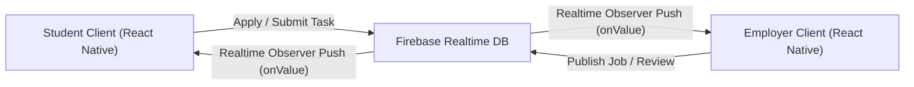

# InternLink — High-School & University Internship Platform

[-1D4ED8?style=for-the-badge&logo=android)](https://github.com/Kush-Bhattacharya/internlink-app/releases/download/v1.0.0/InternLink-v1.0.0.apk)

> **InternLink** is a comprehensive, dual-sided mobile platform designed to bridge the gap between high school/university students seeking meaningful industry experience and verified employers scouting emerging talent.

---

## 📱 How to Try the App Right Now

You can test the application using two methods without needing developer tools:

### Method 1: iPhone Simulation (Samsung "Try Galaxy" Style)
Just like Samsung's "Try Galaxy on iPhone" experience, you can run a full-screen, native-feeling simulation of InternLink directly on your iPhone without going through the App Store:

1. Open **[https://kush-bhattacharya.github.io/internlink-app/](https://kush-bhattacharya.github.io/internlink-app/)** in **Safari** on your iPhone.
2. Tap the **Share** button (`⎋` square with upward arrow) at the bottom of Safari.
3. Scroll down and select **"Add to Home Screen"**.
4. Tap **Add** in the top-right corner.
5. Tap the new **InternLink** app icon on your home screen — it will launch in standalone, full-screen mode with native mobile gestures, role toggles, and live flows!

*Desktop users can also open the link to interact with a realistic smartphone device frame.*

### Method 2: Install Standalone Android App (`.apk`)
For users with an Android phone or Android emulator:
1. Go to the **[Releases Tab](https://github.com/Kush-Bhattacharya/internlink-app/releases)** or click **[Direct Download: InternLink-v1.0.0.apk](https://github.com/Kush-Bhattacharya/internlink-app/releases/download/v1.0.0/InternLink-v1.0.0.apk)** (~103 MB).
2. Open the downloaded `.apk` file on your device and tap **Install** (allow "Install from unknown sources" if prompted).

---

## 💬 We Value Your Feedback!
If you try out the app, please submit your thoughts, bug reports, and suggestions through our official form:

👉 **[Submit Feedback on Google Forms](https://forms.gle/2DrixK9M2mWgT9CQA)**

### Page Reference Guide for Feedback
When filling out the form, refer to this guide to select the exact screen you are giving feedback on:
* **Student Onboarding Questionnaire**: The multi-step setup asking for your education, subjects, and skills.
* **Student Home Dashboard**: The main landing page with greeting, domain categories, and featured roles.
* **Explore All Internships**: The searchable feed of open opportunities with stipend and remote tags.
* **Internship Details & Apply Page**: The full description page with the "Apply Now" button.
* **Student Profile & Digital Resume**: The student resume view with editable skill chips and completeness meter.
* **Employer Dashboard**: The recruiter command center with KPI analytics cards (Active Roles, Candidates, Under Review, Hired).
* **Post New Internship Wizard**: The 4-step stepper for employers to define stipend, perks, and skills.
* **Manage Posted Internships**: The list of all jobs published by a company with candidate counters.
* **Candidate Review & Dossier**: The recruiter's detailed candidate view with evaluation notes and decision buttons.

---

## 🧠 Computer Science & Architectural Concepts Explained

This project was engineered following computer science principles, data structures, and human-computer interaction (HCI) standards.

### 1. System Architecture & BaaS Pattern
InternLink utilizes a **Client-Server Backend-as-a-Service (BaaS)** architecture powered by **Google Firebase Realtime Database**:
* **Reactive Observer Streams**: The client subscribes to real-time data streams using Firebase `onValue()` WebSocket listeners. When an employer changes a candidate's status from `pending` to `accepted`, the student's dashboard updates reactively without manual polling or page reloads.
* **Decoupled Client State**: Local state management is decoupled between transient UI states (active tab, search queries, filter pills) and persistent domain entities (user profile, job listings, candidate submissions).

### 2. Relational Modeling in a NoSQL Hierarchical Tree
To achieve relational integrity within a hierarchical NoSQL JSON structure, normalized composite keys are used:
* `/users/${studentId}` — Stores student candidate credentials, academic records, and technical skill sets.
* `/employers/${employerId}` — Stores verified company data, executive leadership, and compliance metrics.
* `/employers/${employerId}/${postingId}` — Stores individual internship postings published by the employer.
* `/employers/${employerId}/${postingId}/applications/${applicationId}` — Relational join table mapping candidate submissions to specific listings, capturing status (`pending`, `shortlisted`, `accepted`, `rejected`), applied timestamps, and private recruiter evaluation notes.

### 3. Key Algorithms & Computational Complexity
* **Candidate Funnel Aggregation ($O(N)$)**: An accumulator algorithm traverses all active employer listings in a single pass to compute live recruitment metrics:
  $$\text{Funnel Ratio} = \left\{ \frac{N_{\text{pending}}}{N_{\text{total}}}, \frac{N_{\text{shortlisted}}}{N_{\text{total}}}, \frac{N_{\text{accepted}}}{N_{\text{total}}}, \frac{N_{\text{rejected}}}{N_{\text{total}}} \right\}$$
* **Multi-Attribute Filter & Search Engine ($O(M \times K)$)**: Substring match algorithm with case-insensitivity supporting simultaneous filtering across role title, geographic location, stipend threshold, and required technical skills.
* **Non-Destructive Delta Mutations**: State updates utilize atomic Firebase `update()` dictionaries rather than destructive `set()` calls, ensuring nested application sub-trees are never overwritten during company profile modifications.

### 4. Human-Computer Interaction (HCI) Principles
* **Miller's Law (Progressive Disclosure)**: Complex multi-field forms (e.g., Company Registration and Internship Creation) are chunked into 4- and 5-step guided steppers ($7 \pm 2$ items per stage) with real-time validation, minimizing cognitive overload.
* **Fitts's Law (Thumb-Zone Ergonomics)**: Primary navigation controls are anchored in a docked bottom navigation bar with expanded touch-target hit slops ($44 \times 44\text{ pt}$ minimum), facilitating single-handed mobile navigation.
* **Color Psychology & Visual Hierarchy**:
  * **Emerald Green (`#2E7D32`, `#4CAF50`)**: Conveys trust, growth, and career opportunity.
  * **Deep Slate (`#0F172A`, `#334155`)**: Provides typographic clarity and high contrast meeting WCAG AA standards ($>4.5:1$ contrast ratio).
  * **Categorical State Badges**: Under Review (Amber `#E65100`), Shortlisted (Purple `#512DA8`), Accepted (Emerald `#2E7D32`), Rejected (Rose `#C62828`).

---

## 🔒 Architectural Stability & Future-Proofing

Because this is an academic portfolio project, it is engineered to **remain stable and run indefinitely without requiring continuous maintenance or dependency updates**:

1. **Zero-Build Web Runtime (PWA)**:
   The interactive web simulation hosted on GitHub Pages is authored using standardized, vanilla web technologies (HTML5, modern CSS3 custom properties, and native ES6). It requires no Node.js compilation at runtime and has no dependencies that can depreciate or break over time.
2. **Autonomous Compiled Bytecode**:
   The standalone Android `.apk` binary contains pre-compiled Dalvik/ART bytecode and bundled native assets. It executes independently on the device runtime and does not download npm packages or build tools.
3. **Strict Dependency Freezing**:
   In the private source repository, all package versions are pinned in `package-lock.json`, and `.npmrc` is configured with `legacy-peer-deps=true` to prevent peer dependency resolution errors during future builds.

---

## 🛠️ Technology Stack
* **Framework**: React Native 0.88, Expo SDK 58
* **Language**: JavaScript (ES6+), React 19
* **Database & Authentication**: Google Firebase Realtime Database & Firebase Auth
* **Navigation**: React Navigation (Native Stack & Docked Bottom Tabs)
* **Animation & Visuals**: React Native Reanimated, Expo Linear Gradient, Canvas Confetti
* **Hosting & Distribution**: GitHub Pages (Simulation PWA) & EAS Build (Compiled Android APK)

---

## 👨‍💻 Author & Project Context
* **Developer**: Kush Bhattacharya
* **GitHub Profile**: [@Kush-Bhattacharya](https://github.com/Kush-Bhattacharya)
* **Private Source Repo**: `internlink-source` *(Closed-source for academic review)*
* **Feedback Form**: [https://forms.gle/2DrixK9M2mWgT9CQA](https://forms.gle/2DrixK9M2mWgT9CQA)
